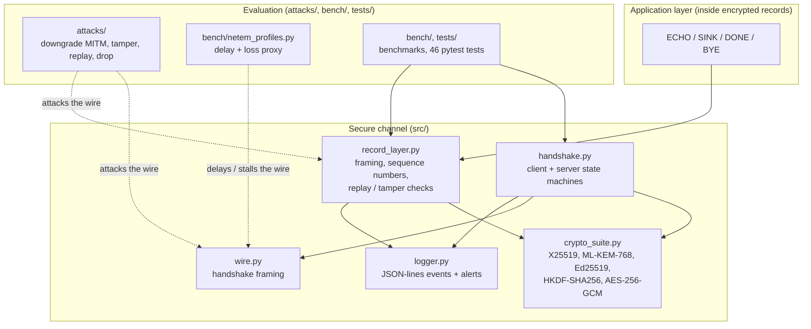
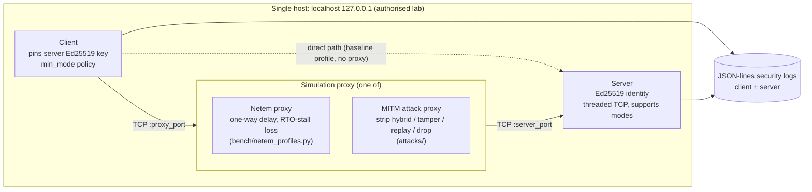
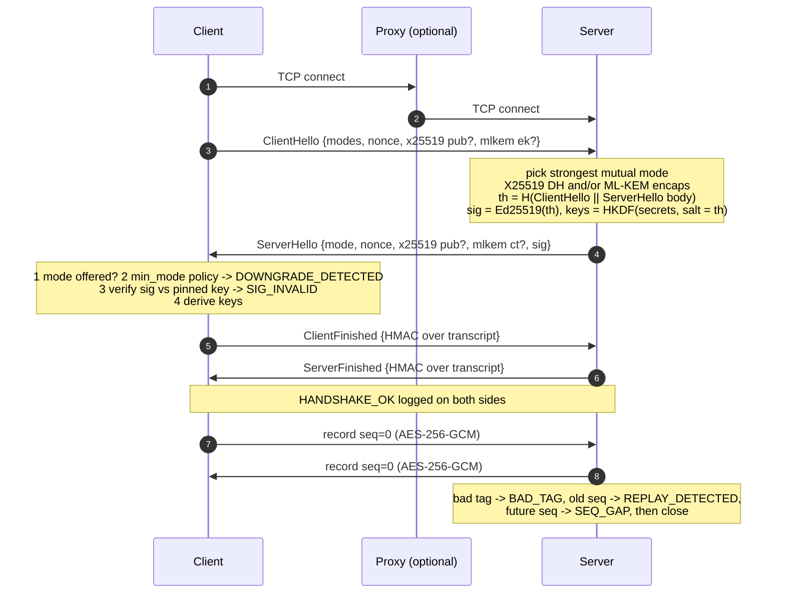

# CHAPTER 3: SYSTEM DESIGN (sections 3.1-3.5)

This chapter presents the architecture, the lab topology, the security mechanism, the protocol workflow and the threat model of the proposed secure channel. Section 3.2 is fully drafted here; sections 3.1, 3.3 and 3.5 summarise material that lives in `docs/architecture.md` and `docs/threat_model.md`, which you can paste into the report with the figures below.

## 3.1 SYSTEM ARCHITECTURE

*Fig. 3.1 Component architecture.* Render with Mermaid (https://mermaid.live, or the VS Code "Markdown Preview Mermaid Support" extension) and export as an image for the Word report.



## 3.2 NETWORK TOPOLOGY DESIGN

All components run on **one machine** (`localhost`, `127.0.0.1`) in an authorised laboratory. There are no routers or firewalls in this topology; the "network" between client and server is a TCP connection, optionally routed through a **simulation proxy** that either emulates network conditions (delay, loss) or acts as an active attacker (man-in-the-middle).

*Fig. 3.2 Network topology (Mermaid).*



*Fig. 3.2 (ASCII alternative, if Mermaid rendering is not available):*

```
 +----------------------------- single host: 127.0.0.1 -----------------------------+
 |                                                                                  |
 |   +----------+  TCP   +--------------------------------+  TCP   +-----------+    |
 |   |  CLIENT  |------->|       SIMULATION PROXY         |------->|  SERVER   |    |
 |   | pinned   |<-------|  (a) netem: delay + RTO stalls |<-------| Ed25519   |    |
 |   | key,     |  port  |  (b) MITM: strip / tamper /    |  port  | identity, |    |
 |   | min_mode |  P_px  |      replay / drop             |  P_srv | all modes |    |
 |   +----+-----+        +--------------------------------+        +-----+-----+    |
 |        |                                                              |          |
 |        |       direct path for the "baseline" profile (no proxy)      |          |
 |        +--------------------------------------------------------------+          |
 |        |                                                              |          |
 |        v                                                              v          |
 |   client.log.jsonl                                              server.log.jsonl |
 +----------------------------------------------------------------------------------+
```

**Components and addresses**

| Component | Role | Address / port |
|---|---|---|
| Client (`src/client.py`) | Initiates the handshake; pins the server key; applies `min_mode` | ephemeral source port |
| Simulation proxy | Either the netem proxy (`bench/netem_profiles.py`) or a MITM proxy (`attacks/`) | ephemeral port (`attacks/` CLIs default to 9444 for downgrade and 9445 for tamper/replay) |
| Server (`src/server.py`) | Listens, runs the handshake, serves ECHO/SINK; logs events | `127.0.0.1:9443` by default (ephemeral in tests/benchmarks) |
| Logs | Append-only JSON lines | `results/*.log.jsonl` |

**Test-bed profiles (path configurations).** *baseline* (direct, no proxy); *proxy_0ms* (through the proxy with no delay, to isolate its overhead); *delay_50ms* (50 ms one-way, RTT about 100 ms); *delay_100ms_loss_1pct* (100 ms one-way, 1 % loss); *loss_5pct* (5 % loss). Loss is an approximation, not real packet loss (see 5.4).

**Packet routing.**
1. The client opens a TCP connection to the proxy's listening port instead of the server's (or directly to the server in the baseline profile).
2. For each accepted connection the proxy opens a second TCP connection to the server and starts two relay directions (client to server and server to client).
3. *Netem mode:* each chunk read from one side is scheduled for release after the one-way delay plus, for every modelled lost segment (per 1460 B), one 200 ms retransmission-timeout stall; chunks are released in order (head-of-line blocking). Bytes are never altered or dropped.
4. *Attack mode:* the proxy parses the two frame formats (handshake `[type][len][payload]`, then records `[len][seq][ciphertext+tag]`) and applies a hook to each frame: rewrite the ClientHello, flip a ciphertext bit, duplicate a record, or drop one. The attacker never has any key.
5. The server answers on the proxied connection; on any integrity failure it logs an event and closes the connection.

## 3.3 PROPOSED SECURITY MECHANISM

Summarise from `docs/architecture.md` sections 3-5 and `docs/threat_model.md` section 3, using this structure:
- **Key exchange per mode:** X25519; ML-KEM-768 encapsulation by the server to the client's key; hybrid = both.
- **Key schedule (Eq. 3.1):** `OKM = HKDF-SHA256(IKM = ss_x25519 || ss_mlkem, salt = H(ClientHello || ServerHello without signature), info = "PQSC1 key schedule|" + mode)`, split into directional keys, nonce prefixes and Finished keys.
- **Authentication:** Ed25519 signature over `H(ClientHello as received || ServerHello without signature)`, verified against the pinned key.
- **Attack prevention:** client `min_mode` policy; signed transcript; Finished MACs; AES-256-GCM with direction and sequence number in the AAD; fail-closed on any record error.

## 3.4 SYSTEM WORKFLOW

*Fig. 3.3 Handshake and data flow.*



Connection establishment in words: TCP connect (to the proxy or the server), four handshake messages (two round trips, i.e. four one-way flights), then encrypted records. The measured handshake of 210 ms at 50 ms one-way delay (classical, median) matches 4 x 50 ms plus compute (Chapter 5).

## 3.5 THREAT MODEL AND SECURITY ANALYSIS

Use `docs/threat_model.md` directly: assets (section 1), attacker capabilities (section 2: on-path active attacker and a harvest-now-decrypt-later adversary), threat/mitigation/event/test table (section 3) and limits (section 4). Add a short **security requirements** list that the rubric asks for:

| Requirement | Mechanism |
|---|---|
| Confidentiality against recorded traffic (including a future quantum attacker) | Hybrid X25519 + ML-KEM-768 key exchange, AES-256-GCM |
| Integrity of every record | GCM tag; direction and sequence number in AAD |
| Server authenticity | Pinned Ed25519 key, signed transcript |
| Downgrade resistance | `min_mode` policy; signature over the exact ClientHello; Finished MACs |
| Replay, reorder and drop resistance | Explicit strictly increasing sequence numbers; fail-closed |
| Detectability | Structured JSON-lines events and real-time alerts |

**Important caveat to state in the report:** Ed25519 authentication is not post-quantum. A quantum attacker able to forge signatures in real time could impersonate the server; ML-DSA is future work.
